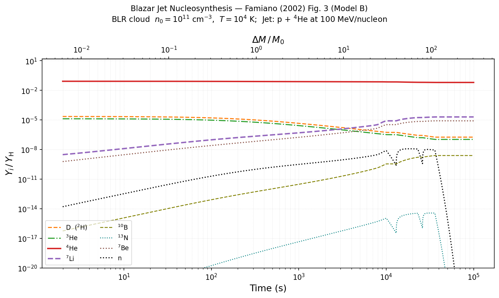
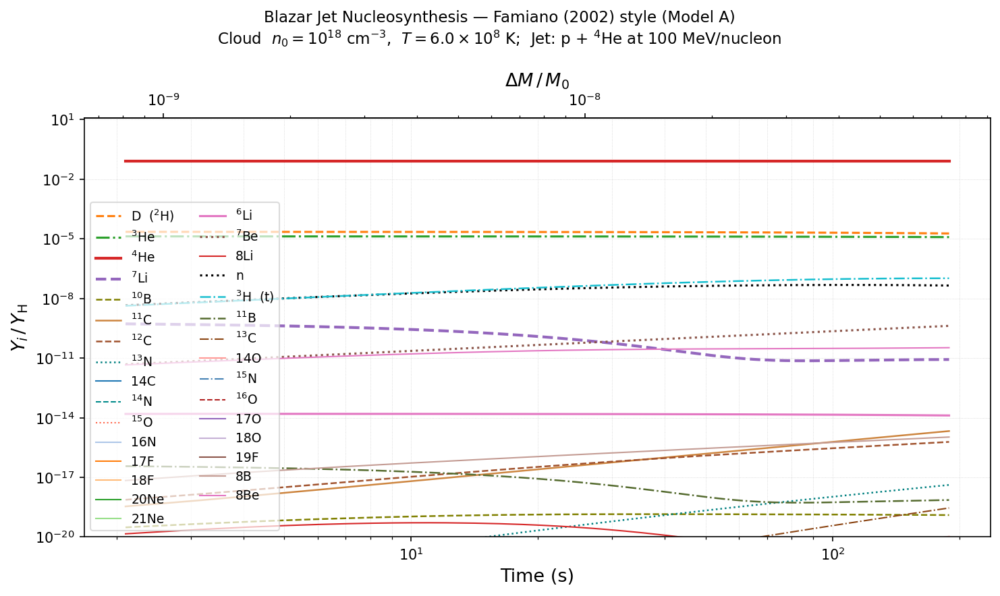

# Thermonuclear network: new species and run speed

**Run analysed:** `outputs/abundance_history.csv` (2026-09-25 12:10), cloud n₀ = 10¹⁸ cm⁻³, T = 6×10⁸ K (T9 = 0.6), thermonuclear reactions on, stopped at t = 189 s (step 17,800). Plot: `famiano_abundance_evolution_17.png` (a copy of the 12:10 `famiano_abundance_evolution.png`, kept so it isn't overwritten by the next run).

**Reference run:** `famiano_abundance_evolution_16.png` (2026-09-03), Model B BLR cloud with n₀ = 10¹¹ cm⁻³, T = 10⁴ K, thermonuclear reactions off, ran to 10⁵ s in 15,508 steps.

All abundances below are **Y/Y_H**, matching the plot axes.

---

## 1. Summary

- The two runs differ in **two ways**: the thermonuclear network is on, *and* the cloud is 10⁷× denser and 6×10⁴× hotter. The new behaviour comes from the second change as much as the first. In a 10⁴ K cloud every thermonuclear rate is effectively zero.
- In the new run the cloud **burns its own material**. For every species, the thermonuclear term alone matches the observed dY/dt to within a few percent. The only mismatches are species also fed or drained by β-decay. The jet's contribution is negligible: the cloud mass M₀ is 10⁷× larger, so ΔM/M₀ reaches only 7×10⁻⁸ by 189 s, against about 10⁻² at 2 s in Model B.
- At T9 = 0.6 the cloud behaves like a small Big Bang nucleosynthesis box. Deuterium and ³He burn; n, t, ⁶Li, ⁷Be and ⁸B appear at levels that match hand calculations; and weak α- and p-capture chains carry a tiny amount of material up to ²¹Ne.
- **Three data bugs** (section 4) inflate ⁸Be, ¹¹C and everything from ¹²C upward. Treat species heavier than ⁸Be as qualitative until they are fixed.
- **Why it's slower (section 5):** dt is pinned at about 0.011 s, against an average of 6.4 s in Model B. The timestep controller never sees radioactive decay, so ⁸B and ⁸Li, which sit in production/decay balance, look as if they change by 100% every τ_decay. Each step is also about 3× more expensive because of the finite-difference Jacobian.

---

## 2. Comparison with `_16` (Model B)

Model B values are read by eye from `_16` at t ≈ 200 s. New-run values are from the CSV at t = 189 s.

| Species | Model B, `_16` (~200 s) | New run (189 s) | What changed |
|---|---|---|---|
| d | ~2×10⁻⁵ (slow decline) | 1.87×10⁻⁵ (−18%) | Burned by d(p,γ)³He, ³He(d,p)α and d+d |
| ³He | ~1×10⁻⁵ | 1.23×10⁻⁵ (−8%) | Burned by ³He(d,p)α; partly refilled by d(p,γ) |
| ⁷Li | ~1×10⁻⁷, **rising** (jet α+α) | 8.5×10⁻¹², **destroyed** | ⁷Li(p,α)α, lifetime ≈ 13 s |
| ⁷Be | ~4×10⁻⁸ | 4.2×10⁻¹⁰ | Now made thermally by ³He(α,γ)⁷Be |
| n | ~5×10⁻¹² | 4.5×10⁻⁸ | From d+d and d+t, not the jet |
| ¹⁰B | ~3×10⁻¹⁴ | 1.3×10⁻¹⁹ | Jet spallation is negligible; the thermal route is weak |
| ¹³N | ~10⁻¹⁹ | 4.2×10⁻¹⁸ | Now from ¹²C(p,γ)¹³N |
| t, ⁶Li, ⁸Be, ⁸B, ⁸Li, ¹¹B, ¹¹C, ¹²C, ¹³C, ¹⁴C, ¹⁴N, ¹⁴O, ¹⁵N, ¹⁵O, ¹⁶N, ¹⁶O, ¹⁷F, ¹⁷O, ¹⁸F, ¹⁸O, ¹⁹F, ²⁰Ne, ²¹Ne | 0 (not on plot) | **new**, see section 3 | Thermonuclear products |

The important physical contrast is that **the Model A cloud destroys lithium instead of making it.** Famiano's Model B builds ⁷Li and ⁷Be from jet α+α reactions in a cold cloud where nothing burns them. In the hot cloud, any ⁷Li is burned by ⁷Li(p,α)α in about 13 s, and ⁷Be comes only from ³He(α,γ).

---

## 3. The new species and why they make sense

Rates are NACRE / CF88 / Bao values of N_A⟨σv⟩ at T9 = 0.6. For a species destroyed by protons, the lifetime is τ = N_A / (Y_p · n · N_A⟨σv⟩) with Y_p · n = 7.5×10¹⁷ cm⁻³.

### 3a. Light species (A ≤ 3): n, t ✅

| Species | Y/Y_H | Made by | Destroyed by | Check |
|---|---|---|---|---|
| n | 4.5×10⁻⁸ | d(d,n)³He, t(d,n)α | p(n,γ)d, τ ≈ 16 s | At equilibrium: production ≈ capture (1.2 vs 2.1×10⁻⁹ s⁻¹, still settling). ✅ |
| t | 1.0×10⁻⁷ | d(d,p)t | t(d,n)α, τ ≈ 70 s | Approaching its equilibrium of about 1.5×10⁻⁷. ✅ |

These are the standard BBN deuterium-burning branches. The two d+d channels have almost equal rates (7.3 and 6.5×10⁶), so n and t are produced about equally, as the plot shows.

### 3b. A = 6–8: lithium, beryllium and boron-8

| Species | Y/Y_H | Made by | Destroyed by | Check |
|---|---|---|---|---|
| ⁶Li | 1.3×10⁻¹⁴ (flat) | d(α,γ)⁶Li | ⁶Li(p,α)³He, τ ≈ 0.4 s | Hand-calculated equilibrium 1.2×10⁻¹⁴, an exact match. ✅ |
| ⁷Be | 4.2×10⁻¹⁰ (rising linearly) | ³He(α,γ)⁷Be at 1.6×10⁻¹² s⁻¹ | ⁷Be(p,γ)⁸B, too slow to matter | Same step as the Sun's pp-II/III chains. ✅ |
| ⁷Li | 8.5×10⁻¹² (now flat) | t(α,γ)⁷Li | ⁷Li(p,α)α, τ ≈ 13 s | The initial ⁷Li burned away in about 60 s. Since then, the growing tritium feeds t(α,γ)⁷Li, which now balances the burning (5.2 vs 5.0×10⁻¹³ s⁻¹). ✅ This is why the curve levels off after ~70 s. |
| ⁸B | 1.1×10⁻¹⁵ | ⁷Be(p,γ)⁸B | β⁺ decay, t½ = 0.77 s | Balance of production and decay, rising with ⁷Be. ✅ |
| ⁸Li | 4×10⁻²¹ | ⁷Li(n,γ)⁸Li | β⁻ decay, t½ = 0.84 s | Balance of production and decay. ✅ |
| **⁸Be** | **3.4×10⁻¹¹** | ⁷Li(p,γ)⁸Be | nothing | ❌ **Not physical.** ⁸Be is unbound and breaks into 2α in ~10⁻¹⁶ s. It builds up only because it has no decay channel (bug 1). |

### 3c. A = 10–11: ¹⁰B, ¹¹B, ¹¹C

| Species | Y/Y_H | Made by | Destroyed by | Check |
|---|---|---|---|---|
| ¹⁰B | 1.3×10⁻¹⁹ | ⁶Li(α,γ)¹⁰B | ¹⁰B(p,α)⁷Be | At equilibrium (1.3 vs 1.3×10⁻²⁰ s⁻¹). ✅ |
| ¹¹B | 7×10⁻¹⁹ | ⁷Li(α,γ)¹¹B | ¹¹B(p,α)2α | ⚠️ The reaction is right, but it is destroyed about 3× too fast (bugs 2 and 3). It falls as the ⁷Li feeding it is burned. |
| ¹¹C | 2.1×10⁻¹⁵ | ⁷Be(α,γ)¹¹C (89%), ¹¹B(p,n)¹¹C (11%, not physical) | β⁺ decay, t½ = 20 min | ⚠️ Mostly physical now that ⁷Be has built up. The ¹¹B(p,n) share comes from a corrupted rate (bug 3); the real rate is 10²² times smaller. |

### 3d. ¹²C to ²¹Ne: α- and p-capture tail ⚠️

The pathways are all genuine reactions and follow the familiar hot-CNO / α-capture pattern:

- ¹²C(p,γ)¹³N(p,γ)¹⁴O (hot CNO)
- ¹³N β⁺ decay to ¹³C, then ¹³C(p,γ)¹⁴N and ¹³C(α,n)¹⁶O
- ¹¹B(α,n)¹⁴N and ¹¹B(α,p)¹⁴C
- ¹⁴N(p,γ)¹⁵O and ¹⁴N(α,γ)¹⁸F
- ¹⁶O(p,γ)¹⁷F, ¹⁴O(α,p)¹⁷F and ¹⁶O(α,γ)²⁰Ne
- ¹⁸O(p,γ)¹⁹F, ¹⁷O(α,γ)²¹Ne, ¹⁵N(n,γ)¹⁶N and so on

**However, the seed is not physical:** 100% of ¹²C production comes from ⁸Be(α,γ)¹²C acting on the ⁸Be that should have decayed (bug 1). Physically this is the second half of triple-alpha burning, which is negligible at ρ ≈ 2×10⁻⁶ g cm⁻³. Without it, ¹²C would come from ¹¹B(p,γ)¹²C at between 1/300 (t ≈ 12 s) and 1/5000 (t = 189 s) of the current rate, and the whole tail would drop by a similar factor. All of these abundances are ≤ 10⁻¹⁵, so they are negligible whether or not the bug is fixed. The chains are correct, but their sizes are not yet reliable.

---

## 4. Data bugs affecting these species

1. **⁸Be has no decay channel.** It is missing from `DECAY_TABLE` (`core/decay.py`). Recommended fix: when rates are loaded, rewrite any ⁸Be product as 2 ⁴He, and remove `4He+8Be->12C` or replace it with a proper three-alpha rate. A 10⁻¹⁶ s decay entry would make the equations very stiff.
2. **¹¹B(p,α) is counted twice.** NACRE_1 loads it as `11B+p->34He` and NACRE_2 (`11bpa8be.dat`) loads it as `11B+p->4He+8Be`; both have N_A⟨σv⟩ = 3.75×10⁶.
3. **The CF88 bundle parser merges tables.** The header regex in `core/rate_library.py` (`_CF88_HEADER_RE`) doesn't match headers such as `B11(P,A)2HE4` or `HE3(E-,NU)H3`. Each unmatched table is appended to the previous reaction's table, and the two are then sorted and interpolated together:

   | Reaction | Real CF88 value, T9 = 0.6 | Loaded | Swallowed table |
   |---|---|---|---|
   | ¹¹B(p,n)¹¹C | 9.9×10⁻¹⁶ | **2.98×10⁶** | B11(P,A)2HE4 |
   | t(t,2n)α | 5.5×10⁶ | 2.1×10⁻¹¹ | HE3(E-,NU)H3 |
   | ⁷Li(α,n)¹⁰B | 1.4×10⁻¹⁵ | 5.7×10⁻¹⁰ | BE7(E-,NU+G)LI7 |

   Fix: split blocks at *every* header line, then filter by species.
4. **¹⁴O has no decay channel.** It should β⁺ decay to ¹⁴N with t½ = 70.6 s.
5. **Two major neutron sinks are missing from the data.** ³He(n,p)t and ⁷Be(n,p)⁷Li are in none of the rate files (NACRE covers charged-particle reactions only). With n ≈ 4×10⁻⁸, ⁷Be(n,p)⁷Li would convert ⁷Be to ⁷Li on a timescale of about 2 hours. That matters for the ⁷Li/⁷Be ratio over a 10⁵ s run.

---

## 5. Why the run is so much slower

| | Model B (`_16`) | New run |
|---|---|---|
| Simulated time | 10⁵ s | 189 s |
| Steps | 15,508 | 17,800 |
| Mean dt | 6.4 s | **0.0106 s** |
| Steps needed to reach 10⁵ s | — | ~9×10⁶ (but `max_steps` = 10⁵ stops the run at ~1,100 s) |

### 5a. Main cause: the timestep controller never sees radioactive decay

In `scripts/run_famiano.py` the step order is: cascade (explicit Euler), then thermonuclear (implicit Euler), then `apply_decay()`, then `compute_next_dt(y_new, delta_y)`. But `y_new` and `delta_y` are captured **before** decay is applied. `delta_y` therefore contains ⁸B's production but not its decay.

For a species sitting in production/decay balance, its production per step is Y·dt/τ_decay. The controller's ratio Y/|ΔY| therefore works out to τ_decay/dt, so equation (4) returns

  dt_next = γ · τ_decay.

The measured values at t = 189 s confirm this:

| Limiting species | Y / (thermonuclear dY/dt) | γ × that | Observed dt |
|---|---|---|---|
| ⁸B (τ = 1.11 s) | 1.10 s | **0.011 s** | 0.0100–0.0111 s |
| ⁸Li (τ = 1.21 s) | 1.21 s | 0.012 s | |

The real net timescales, including decay, are much longer. At 189 s the shortest are ¹⁷O, ¹⁷F, ¹⁶O and ¹⁸F at about 35–46 s, and ⁶Li and n are at ≥ 10³ s. Those would allow dt ≈ 0.35–0.45 s now, growing roughly in proportion to t because the dominant species are growing from zero.

In Model B this never came up, because nothing populated ⁸B or ⁸Li above the controller's `rel_floor` of 10⁻³⁰.

**Fix:** compute `delta_y` over the whole step, including decay (Y after decay minus Y at the start of the step), and pass the post-decay Y to `compute_next_dt`. Estimated gain: about 30–40× larger dt now, and a run to 10⁵ s taking thousands of steps instead of millions. The jet on/off transitions will still briefly reset dt to `dt_min`.

### 5b. Secondary cause: each step is ~3× more expensive

`jacobian.implicit_euler_step` builds a finite-difference Jacobian. That is about 38 evaluations of `compute_thermonuclear_dydt`, each a Python loop over 92 reactions for 32 species:

- one RHS evaluation: 1.9 ms
- one implicit step: 72 ms, about 45% of the ~0.16 s wall time per step

**Fix (optional):** every reaction is two-body, so the analytic Jacobian is simple. For R = n·⟨σv⟩·Y_i·Y_j/(1+δ_ij), the derivative with respect to Y_i is n·⟨σv⟩·Y_j/(1+δ_ij) (and 2n⟨σv⟩Y_i/2 for identical reactants), spread over the reaction's reactants and products. Building it in a single pass replaces about 38 RHS calls with one.

### Estimated wall time to reach 10⁵ s

- **As is:** ~9×10⁶ steps × ~0.16 s ≈ 17 days, and `max_steps` stops the run long before that.
- **With fix 5a:** a few thousand steps, i.e. minutes.
- **With 5a and 5b:** under a minute of thermonuclear cost.

---

## 6. Method

- The contribution of each reaction was found by evaluating `compute_thermonuclear_dydt` with a single-reaction `ThermonuclearLibrary` at the last CSV row. The thermonuclear total was compared with the observed dY/dt between the last 6 written rows.
- The CF88 values were checked line by line against `data/ReactionRates/Thermal/CF88/web_data.dat`.
- Timing was measured with `time.perf_counter` on this machine at the t = 189 s state.
- Model B values are read by eye from the `_16` plot, because its CSV has since been overwritten.
